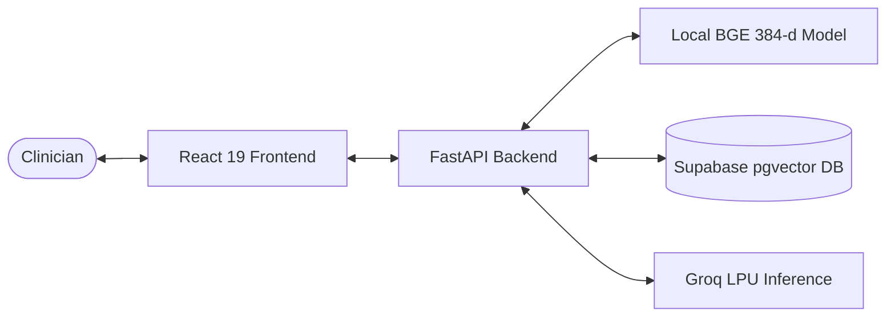

# AI-Assistant for Dynamic Clinical Guideline Navigator

[](https://fastapi.tiangolo.com)
[](https://react.dev)
[](https://supabase.com)
[](https://groq.com)
[](https://huggingface.co/BAAI/bge-small-en-v1.5)
[](LICENSE)

An enterprise-grade, evidence-grounded Clinical Decision Support System (CDSS) pairing high-throughput Retrieval-Augmented Generation (RAG) over authoritative international clinical practice guidelines with patient-specific contextualization, structured clinical guidance, and an immutable decision audit trail.

---

## Table of Contents
1. [Project Description](#1-project-description)
2. [Problem Statement](#2-problem-statement)
3. [Objectives](#3-objectives)
4. [Key Features](#4-key-features)
5. [System Architecture](#5-system-architecture)
6. [Technology Stack](#6-technology-stack)
7. [Five-Step Clinical Workflow](#7-five-step-clinical-workflow)
8. [RAG Pipeline Explanation](#8-rag-pipeline-explanation)
9. [Guideline Ingestion Pipeline](#9-guideline-ingestion-pipeline)
10. [Hybrid & Vector Retrieval](#10-hybrid--vector-retrieval)
11. [Decision Navigation](#11-decision-navigation)
12. [Clinician Review & Oversight](#12-clinician-review--oversight)
13. [Audit Logging & Compliance](#13-audit-logging--compliance)
14. [Evaluation & Testing Results](#14-evaluation--testing-results)
15. [Installation Instructions](#15-installation-instructions)
16. [Environment Setup](#16-environment-setup)
17. [Running the Frontend](#17-running-the-frontend)
18. [Running the Backend](#18-running-the-backend)
19. [Database Setup & Migrations](#19-database-setup--migrations)
20. [REST API Overview](#20-rest-api-overview)
21. [Application Screenshots](#21-application-screenshots)
22. [Limitations & Responsible Use](#22-limitations--responsible-use)
23. [Technical Documentation Index](#23-technical-documentation-index)
24. [Contributors](#24-contributors)
25. [License](#25-license)

---

## 1. Project Description
The **Clinical Guideline Navigator** is an evidence-grounded artificial intelligence clinical decision support system designed for healthcare practitioners at the point of care. By indexing authoritative clinical practice guidelines from international health authorities (including NICE, KDIGO, AHA/ACC/HFSA, and CDC) into PostgreSQL using `pgvector`, the system allows clinicians to rapidly query complex medical literature, receive grounded answers citing exact PDF page numbers, contextualize guidance to active patient conditions, and log clinical actions in a medical-legal audit trail.

---

## 2. Problem Statement
Modern clinical practice guidelines are extensive, multi-hundred-page documents that are difficult to query during time-compressed patient consultations. Busy clinicians often lack the time to manually search through voluminous PDFs, resulting in delayed guideline adoption or risky reliance on general-purpose AI tools that hallucinate unverified medical advice. Generic AI models lack patient-specific clinical context, cannot verify official guideline page numbers, and offer no audit trail for institutional accountability.

---

## 3. Objectives
- **Zero Fabrication:** Rely strictly on retrieved clinical evidence, explicitly warning clinicians when evidence is insufficient rather than inventing treatment advice.
- **Patient Context Integration:** Dynamically incorporate active patient diagnoses, active medications, allergies, and vitals into clinical synthesis while protecting Protected Health Information (PHI).
- **Sub-Second Retrieval:** Index clinical literature using 384-dimensional dense vectors (`BAAI/bge-small-en-v1.5`) and HNSW cosine similarity search.
- **Multi-Specialty Coverage:** Support comprehensive guidelines across 8 canonical specialties (Nephrology, Pain Management, Endocrinology, Diabetes, Cardiovascular, Hypertension, Infectious Disease, General).
- **Human-in-the-Loop Governance:** Provide clinicians with structured decision governance actions (Accept, Modify, Reject) persisted in an immutable audit trail.

---

## 4. Key Features
- **Evidence-Grounded Synthesis:** System instructions strictly penalize extrapolation, requiring conditional wording based on verified clinical thresholds.
- **Direct Official PDF Access:** Guideline cards and evidence excerpts provide direct `[Open PDF ↗]` links opening the official source PDF in a new tab.
- **Multi-Category Tagging:** Guidelines spanning multiple domains (e.g., KDIGO covering Nephrology & Diabetes) appear across relevant category tabs without database duplication.
- **Quality Control Upload Pipeline:** Automated SHA-256 analysis, structural PDF inspection, clinical authenticity scoring, and edition detection for newly ingested guidelines.
- **Clinical Report Export:** Generate formatted consultation summaries in PDF or DOCX format for electronic medical records.

---

## 5. System Architecture

For a complete architectural breakdown, see [`docs/SYSTEM_ARCHITECTURE.md`](docs/SYSTEM_ARCHITECTURE.md).

---

## 6. Technology Stack
- **Frontend:** React 19, TypeScript, Vite, Tailwind CSS, Lucide React, React Router DOM v7.
- **Backend:** Python 3.11, FastAPI, Pydantic v2, Uvicorn, PyPDF/pypdf, ReportLab, python-docx.
- **Embeddings:** Hugging Face `sentence-transformers` (`BAAI/bge-small-en-v1.5`, 384-dim normalized dense vectors).
- **Database & Auth:** Supabase PostgreSQL 15+, `pgvector` extension, HNSW cosine index, Row Level Security (RLS).
- **LLM Inference:** Groq Cloud API (`qwen/qwen3.8-27b`).

---

## 7. Five-Step Clinical Workflow
1. **Patient Selection:** Clinician chooses an authorized patient profile or proceeds with general inquiry.
2. **Clinical Inquiry:** Clinician enters a focused clinical question or selects from evidence-based suggestions.
3. **Evidence Retrieval:** The system retrieves top-k matching guideline chunks meeting similarity thresholds.
4. **Structured Guidance:** The assistant synthesizes a grounded response with summary, patient context alignment, recommendations, safety considerations, and missing test alerts.
5. **Decision Governance:** Clinician reviews citations, opens official source PDFs, and formally records decision status (Accept, Modify with rationale, or Reject) into the audit log.

---

## 8. RAG Pipeline Explanation
The 7-stage RAG pipeline consists of:
1. **Intent Triage:** Query Router diverts greetings and out-of-scope prompts.
2. **Context Enrichment:** Pertinent patient conditions enrich the query vector.
3. **Local Embedding:** 384-dimensional dense vector generated via `bge-small-en-v1.5`.
4. **Vector Retrieval:** Cosine similarity search via PostgreSQL RPC `match_guideline_chunks`.
5. **Sufficiency Evaluation:** Queries failing minimum similarity (`0.45`) return an insufficiency advisory.
6. **Grounded Synthesis:** Groq LLM synthesizes structured recommendations using retrieved excerpts only.
7. **Provenance Resolution:** Source metadata, section titles, page numbers, and PDF URLs are mapped to evidence cards.

For full technical specifications, see [`docs/RAG_PIPELINE.md`](docs/RAG_PIPELINE.md).

---

## 9. Guideline Ingestion Pipeline
Uploaded documents pass through automated quality control:
- PDF structural validity and readable text layer verification.
- Clinical lexicon authenticity scoring (rejects recipes, code, marketing, or general text).
- SHA-256 cryptographic hash computation to block exact duplicates.
- Sliding window section-aware chunking (400–600 tokens with 50-token overlap).

For details, see [`docs/GUIDELINE_INGESTION.md`](docs/GUIDELINE_INGESTION.md).

---

## 10. Hybrid & Vector Retrieval
Vector similarity is computed via PostgreSQL's HNSW index:
$$\text{Similarity} = 1 - (\text{embedding} \Leftrightarrow \text{query\_embedding})$$
The system filters by minimum similarity (`match_threshold >= 0.45`) and optionally scopes to specific guidelines. Lexical category filtering ensures relevant specialty bounds are respected.

---

## 11. Decision Navigation
The user interface features a dedicated Decision Support overview displaying historical and pending decisions, categorizing recommendations by clinical urgency and review status.

---

## 12. Clinician Review & Oversight
Generative AI outputs cannot be applied automatically. The platform mandates human-in-the-loop review. Clinicians inspect the verbatim evidence excerpt, verify the source page in the official PDF, and explicitly register their decision.

---

## 13. Audit Logging & Compliance
All clinical decisions are permanently recorded in `public.clinical_decisions`. The table enforces an append-only policy with no `UPDATE` or `DELETE` capabilities for standard users, establishing an immutable audit trail for medical-legal compliance.

---

## 14. Evaluation & Testing Results
- **Automated Regression Suite:** 28 passing tests across unit, integration, and RAG verification modules:
  - `backend/tests/test_guideline_qc.py` (7/7 PASS)
  - `backend/tests/test_patient_validation.py` (5/5 PASS)
  - `backend/tests/test_phase12_6_guideline_library.py` (9/9 PASS)
  - `backend/tests/test_router_and_rag.py` (7/7 PASS)
- **Retrieval Performance:** Sub-second retrieval latency (~0.69s) with top cosine similarity scores >0.80 across NICE, KDIGO, and CDC guidelines.
- **Frontend Build:** Built cleanly in 2.15 seconds with 0 TypeScript errors.

For full test reports, see [`docs/TESTING_AND_EVALUATION.md`](docs/TESTING_AND_EVALUATION.md).

---

## 15. Installation Instructions
### Prerequisites
- Node.js 18+ and npm 9+
- Python 3.11.x
- Git

Clone the repository:
```bash
git clone https://github.com/<your-username>/clinical-guideline-navigator.git
cd clinical-guideline-navigator
```

---

## 16. Environment Setup
Copy the template files:
```bash
# Backend
cp backend/.env.example backend/.env

# Frontend
cp frontend/.env.example frontend/.env.local
```
Configure your `backend/.env` with your Supabase URL, Service Role Key, and Groq API Key. Configure `frontend/.env.local` with your Supabase URL and Publishable Anon Key.

---

## 17. Running the Frontend
```bash
cd frontend
npm install
npm run dev
```
Open [http://localhost:5173](http://localhost:5173).

---

## 18. Running the Backend
```bash
# In backend directory
python -m venv .venv
# Activate virtual environment (.venv\Scripts\activate on Windows, source .venv/bin/activate on Unix)
pip install -r requirements.txt
python -m uvicorn app.main:app --app-dir backend --host 127.0.0.1 --port 8000 --reload
```
Interactive API docs: [http://127.0.0.1:8000/docs](http://127.0.0.1:8000/docs).

---

## 19. Database Setup & Migrations
Execute the SQL migrations in `database/migrations/` sequentially in the Supabase SQL Editor:
1. `001_patients.sql`
2. `002_guidelines.sql`
3. `003_rag.sql`
4. `004_clinical_decisions.sql`
5. `005_fix_schema_compatibility.sql`
6. `006_patient_email_and_validation.sql`
7. `007_safe_guideline_cleanup.sql`

For detailed schema documentation, see [`docs/DATABASE_DESIGN.md`](docs/DATABASE_DESIGN.md).

---

## 20. REST API Overview
- `GET /api/health` — System and database connectivity check.
- `POST /api/assistant/query` — Execute patient-aware RAG query.
- `POST /api/guidelines/validate` — Validate uploaded guideline PDF and extract metadata.
- `POST /api/guidelines/upload` — Ingest, chunk, embed, and index new guideline.
- `POST /api/patients/validate` — Validate and normalize patient profile.
- `POST /api/reports/export` — Generate clinical consultation note in PDF or DOCX.

See [`docs/API_DOCUMENTATION.md`](docs/API_DOCUMENTATION.md) for request/response payloads.

---

## 21. Application Screenshots
Screenshots and visual workflow documentation are organized in [`docs/screenshots/`](docs/screenshots/):
- **QC Ingestion Modal:** Automated SHA-256 analysis and guideline authenticity validation.
- **Guidelines Library:** Multi-category badges and direct `[Open PDF ↗]` buttons.
- **Assistant View:** Patient context card, evidence excerpts, and structured guidance.
- **Decision Governance:** Accept / Modify / Reject clinical governance modals.

---

## 22. Limitations & Responsible Use
- **Decision Support Only:** This platform is an assistive decision support tool for licensed healthcare professionals. It does not replace human clinical judgment.
- **No Autonomous Prescribing:** The system cannot order medications or prescribe therapies autonomously.
- **Not for Emergency Triage:** The system is not engineered for emergency resuscitation or immediate trauma triage.

See [`docs/SECURITY_AND_PRIVACY.md`](docs/SECURITY_AND_PRIVACY.md).

---

## 23. Technical Documentation Index
- [Academic Project Report](docs/PROJECT_REPORT.md)
- [System Architecture Specification](docs/SYSTEM_ARCHITECTURE.md)
- [Database Design & Schema](docs/DATABASE_DESIGN.md)
- [RAG Pipeline Technical Manual](docs/RAG_PIPELINE.md)
- [REST API Reference](docs/API_DOCUMENTATION.md)
- [Guideline Ingestion & QC](docs/GUIDELINE_INGESTION.md)
- [Security, Privacy & RLS](docs/SECURITY_AND_PRIVACY.md)
- [Testing & Evaluation Framework](docs/TESTING_AND_EVALUATION.md)
- [Installation & Setup Guide](docs/INSTALLATION_AND_SETUP.md)
- [Clinician Operating Guide](docs/USER_GUIDE.md)

---

## 24. Contributors
- **Clinical Navigator Development Team**
- Department of Computer Science & Engineering / Health Informatics
- Academic Evaluation & Clinical Peer Review

---

## 25. License
This project is licensed under the [MIT License](LICENSE).
