# Database Design & Schema Specification

This document provides the complete database schema, entity-relationship models, pgvector indexing strategy, Row Level Security (RLS) policies, and migration history for the **Clinical Guideline Navigator** hosted on Supabase PostgreSQL.

---

## 1. Entity-Relationship Model

```mermaid
erDiagram
    PATIENTS ||--o{ CLINICAL_DECISIONS : "subject of"
    GUIDELINES ||--o{ GUIDELINE_DOCUMENTS : "contains"
    GUIDELINES ||--o{ GUIDELINE_CHUNKS : "chunked into"
    GUIDELINE_DOCUMENTS ||--o{ GUIDELINE_CHUNKS : "originates"
    CLINICAL_DECISIONS }o--|| GUIDELINES : "cites"

    PATIENTS {
        uuid id PK
        uuid clinician_id FK
        text full_name
        date date_of_birth
        text gender
        text email
        text phone
        text address
        text_array medical_conditions
        text_array allergies
        text_array medications
        text medical_history
        timestamptz created_at
        timestamptz updated_at
    }

    GUIDELINES {
        uuid id PK
        text title
        text organization
        int year
        text category
        text description
        text source_url
        text pdf_url
        text status
        text source_type
        text verification_status
        boolean is_verified
        timestamptz created_at
        timestamptz updated_at
    }

    GUIDELINE_DOCUMENTS {
        uuid id PK
        uuid guideline_id FK
        text file_name
        text document_name
        text document_version
        text checksum
        text pdf_url
        int page_count
        text ingestion_status
        timestamptz created_at
    }

    GUIDELINE_CHUNKS {
        uuid id PK
        uuid guideline_id FK
        uuid document_id FK
        int chunk_index
        text content
        int page_number
        text section_title
        text source_url
        text pdf_url
        vector_384 embedding
        timestamptz created_at
    }

    CLINICAL_DECISIONS {
        uuid id PK
        uuid patient_id FK
        uuid clinician_id FK
        uuid guideline_id FK
        text query_text
        text decision_text
        text decision_status
        text rationale
        text modification_notes
        jsonb evidence_sources
        timestamptz created_at
    }
```



---

## 2. Table Schemas & Constraints

### 2.1. `public.patients`
Stores patient clinical profiles. PII columns are protected by clinician-scoped RLS.
```sql
CREATE TABLE public.patients (
    id UUID PRIMARY KEY DEFAULT gen_random_uuid(),
    clinician_id UUID REFERENCES auth.users(id) ON DELETE CASCADE,
    full_name TEXT NOT NULL,
    date_of_birth DATE,
    gender TEXT,
    email TEXT,
    phone TEXT,
    address TEXT,
    medical_conditions TEXT[] DEFAULT '{}',
    allergies TEXT[] DEFAULT '{}',
    medications TEXT[] DEFAULT '{}',
    medical_history TEXT,
    created_at TIMESTAMPTZ NOT NULL DEFAULT now(),
    updated_at TIMESTAMPTZ NOT NULL DEFAULT now()
);
```

### 2.2. `public.guidelines`
Stores official clinical practice guideline metadata and categories.
```sql
CREATE TABLE public.guidelines (
    id UUID PRIMARY KEY DEFAULT gen_random_uuid(),
    title TEXT NOT NULL,
    organization TEXT NOT NULL,
    year INTEGER,
    category TEXT NOT NULL,
    description TEXT,
    source_url TEXT,
    pdf_url TEXT,
    status TEXT NOT NULL DEFAULT 'active' CHECK (status IN ('active', 'archived', 'draft')),
    source_type TEXT DEFAULT 'official',
    verification_status TEXT DEFAULT 'verified',
    is_verified BOOLEAN DEFAULT true,
    created_at TIMESTAMPTZ NOT NULL DEFAULT now(),
    updated_at TIMESTAMPTZ NOT NULL DEFAULT now()
);
```

### 2.3. `public.guideline_documents`
Stores physical document artifacts, SHA-256 integrity checksums, and versions.
```sql
CREATE TABLE public.guideline_documents (
    id UUID PRIMARY KEY DEFAULT gen_random_uuid(),
    guideline_id UUID NOT NULL REFERENCES public.guidelines(id) ON DELETE CASCADE,
    file_name TEXT,
    document_name TEXT,
    document_version TEXT DEFAULT 'Not specified',
    checksum TEXT NOT NULL,
    pdf_url TEXT,
    page_count INTEGER,
    ingestion_status TEXT DEFAULT 'completed',
    created_at TIMESTAMPTZ NOT NULL DEFAULT now()
);
```

### 2.4. `public.guideline_chunks`
Stores text segments, section headings, page numbers, and dense vector embeddings.
```sql
CREATE TABLE public.guideline_chunks (
    id UUID PRIMARY KEY DEFAULT gen_random_uuid(),
    document_id UUID REFERENCES public.guideline_documents(id) ON DELETE CASCADE,
    guideline_id UUID NOT NULL REFERENCES public.guidelines(id) ON DELETE CASCADE,
    chunk_index INTEGER NOT NULL,
    content TEXT NOT NULL,
    page_number INTEGER,
    section_title TEXT,
    source_url TEXT,
    pdf_url TEXT,
    embedding VECTOR(384),
    created_at TIMESTAMPTZ NOT NULL DEFAULT now()
);

-- HNSW Vector Index for Sub-second Cosine Retrieval
CREATE INDEX idx_guideline_chunks_embedding 
    ON public.guideline_chunks 
    USING hnsw (embedding vector_cosine_ops);

CREATE INDEX idx_guideline_chunks_guideline_id 
    ON public.guideline_chunks(guideline_id);
```

### 2.5. `public.clinical_decisions`
Stores immutable medical-legal audit logs of clinician actions.
```sql
CREATE TABLE public.clinical_decisions (
    id UUID PRIMARY KEY DEFAULT gen_random_uuid(),
    patient_id UUID NOT NULL REFERENCES public.patients(id) ON DELETE CASCADE,
    clinician_id UUID NOT NULL REFERENCES auth.users(id) ON DELETE CASCADE,
    guideline_id UUID REFERENCES public.guidelines(id) ON DELETE SET NULL,
    query_text TEXT NOT NULL,
    decision_text TEXT NOT NULL,
    decision_status TEXT NOT NULL CHECK (decision_status IN ('accepted', 'modified', 'rejected')),
    rationale TEXT,
    modification_notes TEXT,
    evidence_sources JSONB DEFAULT '[]'::jsonb,
    created_at TIMESTAMPTZ NOT NULL DEFAULT now()
);
```

---

## 3. Vector Similarity Stored Procedure

The backend executes semantic similarity queries through the stored procedure `match_guideline_chunks`:

```sql
CREATE OR REPLACE FUNCTION match_guideline_chunks(
    query_embedding vector(384),
    match_threshold float DEFAULT 0.40,
    match_count int DEFAULT 5,
    filter_guideline_id uuid DEFAULT NULL
)
RETURNS TABLE (
    id uuid,
    guideline_id uuid,
    document_id uuid,
    chunk_index integer,
    content text,
    page_number integer,
    section_title text,
    source_url text,
    pdf_url text,
    guideline_title text,
    organization text,
    similarity float
)
LANGUAGE plpgsql
STABLE
AS $$
BEGIN
    RETURN QUERY
    SELECT
        gc.id,
        gc.guideline_id,
        gc.document_id,
        gc.chunk_index,
        gc.content,
        gc.page_number,
        gc.section_title,
        gc.source_url,
        gc.pdf_url,
        g.title AS guideline_title,
        g.organization,
        (1 - (gc.embedding <=> query_embedding))::float AS similarity
    FROM public.guideline_chunks gc
    JOIN public.guidelines g ON gc.guideline_id = g.id
    WHERE 
        (filter_guideline_id IS NULL OR gc.guideline_id = filter_guideline_id)
        AND (1 - (gc.embedding <=> query_embedding)) >= match_threshold
    ORDER BY gc.embedding <=> query_embedding ASC
    LIMIT match_count;
END;
$$;
```

---

## 4. Row Level Security (RLS) Policies

All tables enforce Row Level Security:
- **`guidelines`, `guideline_documents`, `guideline_chunks`:**
  - Accessible for `SELECT` by all authenticated clinicians (`auth.role() = 'authenticated'`).
  - Read-only to standard clinicians; mutations restricted to administrative service roles.
- **`patients`:**
  - Clinicians can only view, insert, and update patient records where `clinician_id = auth.uid()`.
- **`clinical_decisions`:**
  - Clinicians can only select and insert decisions where `clinician_id = auth.uid()`.
  - Immutable: No update or delete policies exist for standard users, preserving the medical-legal audit trail.

---

## 5. Migration History (`database/migrations/`)
1. `001_patients.sql`: Initial patient tables, contact fields, and clinician RLS.
2. `002_guidelines.sql`: Guidelines and documents core schema.
3. `003_rag.sql`: Vector extension enablement and legacy chunks.
4. `004_clinical_decisions.sql`: Decision audit log schema and status checks.
5. `005_fix_schema_compatibility.sql`: Creation of `guideline_chunks` for 384-d vectors, HNSW index, and `match_guideline_chunks` RPC.
6. `006_patient_email_and_validation.sql`: Patient contact normalization and email checks.
7. `007_safe_guideline_cleanup.sql`: Transactional duplicate removal RPC and backup verification.
