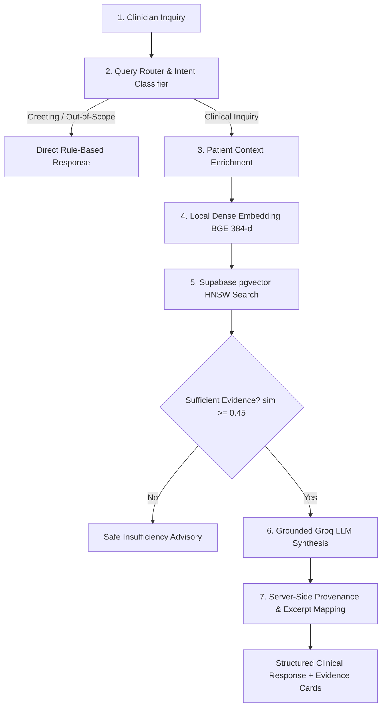

# Retrieval-Augmented Generation (RAG) Pipeline

This document explains the evidence-grounded Retrieval-Augmented Generation (RAG) pipeline powering the **Clinical Guideline Navigator**.

---

## 1. Pipeline Overview

The RAG pipeline operates through a 7-stage sequential architecture:

---

## 2. Stage Breakdown

### Stage 1 & 2: Query Triage & Classification (`app/services/query_router.py`)
Before querying vector indexes, incoming prompts pass through the Query Router to classify intent:
- **`greeting`:** Friendly clinical assistant acknowledgment without triggering database load.
- **`out_of_scope`:** Politely declines non-medical inquiries (sports, coding, general trivia).
- **`unclear`:** Prompts the clinician to clarify short or ambiguous queries.
- **`healthcare`:** Routes clinical inquiries to the retrieval pipeline.

### Stage 3: Patient Context Enrichment (`app/services/retrieval.py`)
When a clinician selects an authorized patient:
- The backend retrieves active diagnoses (`medical_conditions`), medications, allergies, and clinical vitals.
- Pertinent conditions (e.g., "stage 3 CKD", "type 2 diabetes") are appended to the query if not already present in the prompt.
- **Privacy Boundary:** Patient identifiers (names, dates of birth, contact details) are never embedded or exposed.

### Stage 4: Dense Vector Embedding (`app/services/embeddings.py`)
- **Model:** `BAAI/bge-small-en-v1.5` running locally via `sentence-transformers`.
- **Search Prompt:** Uses the official BGE query representation prefix:
  `"Represent this sentence for searching relevant clinical passages: {query}"`
- **Output:** 384-dimensional dense vector normalized to unit length for exact cosine similarity calculation.

### Stage 5: Vector Similarity Retrieval (`app/services/retrieval.py`)
- Executes the `match_guideline_chunks` RPC in PostgreSQL.
- Compares the query vector against all indexed chunks using HNSW cosine distance (`1 - (embedding <=> query_embedding)`).
- Chunks must meet the strict minimum similarity threshold (`SIMILARITY_THRESHOLD = 0.45`, default top-k = 5).

### Stage 6: Evidence Grounding & Groq Synthesis (`app/services/groq_service.py`)
- **Model:** `qwen/qwen3.8-27b` hosted on Groq Cloud LPU inference.
- **System Instructions Enforce:**
  1. Rely **ONLY** on the provided retrieved evidence chunks.
  2. Frame dosage and drug class recommendations as strictly **conditional** upon verifying baseline values (e.g., eGFR, ACR, potassium).
  3. Explicitly list any missing diagnostic laboratory values under a dedicated section.
  4. Clearly segregate secondary supporting references (e.g., clinician community notes) from official guidelines.

### Stage 7: Citation Resolution & Excerpt Formatting (`app/services/rag.py`)
- Formats evidence items into `SourceItem` objects containing:
  - `guideline_id` (UUID)
  - `title` (Official guideline title)
  - `organization` (Issuing health authority: NICE, KDIGO, AHA/ACC/HFSA, CDC)
  - `section` (Chapter/section name)
  - `page` (Exact PDF page number)
  - `excerpt` (Verbatim excerpt up to 260 characters)
  - `similarity` (Cosine score)
  - `pdf_url` (Direct link to official PDF document)

---

## 3. Response Structure Standardization

When patient context is present, responses follow a 7-part clinical format:
1. `### 1. Clinical Summary` (Direct 2-3 sentence overview)
2. `### 2. Relevant Patient Context` (Specific parameters pertinent to the question)
3. `### 3. Clinical Assessment` (Alignment with guideline criteria)
4. `### 4. Evidence-Based Recommendations` (Numbered conditional steps)
5. `### 5. Safety Considerations & Monitoring` (Adverse risks, drug interactions, renal thresholds)
6. `### 6. Missing Clinical Information & Recommended Tests` (Baseline lab values needed before final therapy)
7. `### 7. Clinical Sources` (Numbered citations with section and page numbers)

When no patient is selected:
- Responses are titled: `### General Clinical Guideline Advisory (No Patient Context Selected)`.
