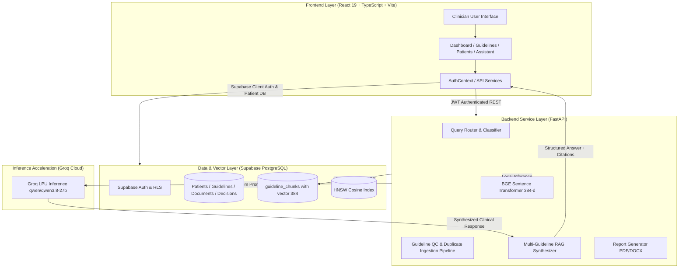
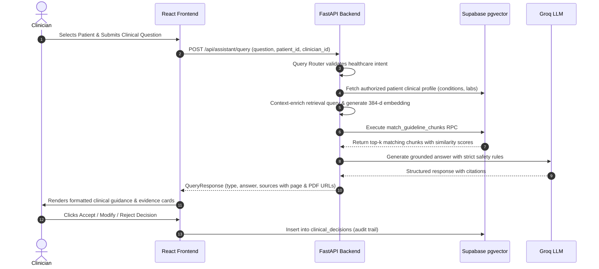

# System Architecture & Technical Specification

This document details the software architecture, data flow, component interactions, and infrastructure boundaries of the **AI-Assistant for Dynamic Clinical Guideline Navigator**.

---

## 1. Frontend Architecture
- **Framework & Runtime:** React 19, TypeScript 5.8+, Vite 8.3 build tool.
- **Styling & Design System:** Tailwind CSS with Lucide React icons, mobile-responsive collapsible sidebar, and accessible modal overlays.
- **State Management & Routing:** 
  - React Context (`AuthContext.tsx`) manages session state and current authenticated clinician profile.
  - React Router DOM v7 manages protected routing (`/dashboard`, `/assistant`, `/patients`, `/guidelines`, `/settings`).
- **Domain Libraries (`src/lib/`):**
  - `assistant.ts`: Dispatches queries to FastAPI backend (`/api/assistant/query`) with patient and clinician authorization.
  - `guidelines.ts`: Direct Supabase queries with joins across `guideline_documents` for versioning, status, and PDF links.
  - `patients.ts`: Manages CRUD operations and clinical condition tags under Supabase RLS.
  - `decisions.ts`: Persists structured clinician actions (`accepted`, `modified`, `rejected`) with justification notes.
  - `reports.ts`: Requests formatted PDF/DOCX clinical summaries.

---

## 2. Backend Service Architecture
- **Runtime:** Python 3.11 with FastAPI and Uvicorn ASGI server.
- **Microservice Endpoints (`app/routers/`):**
  - `assistant.py`: Serves `/api/assistant/query` handling clinical inquiries and evidence synthesis.
  - `guidelines.py`: Serves `/api/guidelines/validate`, `/upload`, and `/fix-categories` for QC ingestion and metadata management.
  - `patients.py`: Serves `/api/patients/validate` for sanitization and schema verification.
  - `reports.py`: Serves `/api/reports/export` generating clinical documentation.
- **Local Embedding Engine (`app/services/embeddings.py`):**
  - Model: `BAAI/bge-small-en-v1.5` loaded locally via `sentence-transformers`.
  - Dimensions: 384 floats, normalized for exact cosine distance calculation.
  - Fallback Protection: Raises `EmbeddingModelUnavailableError` if weights are missing; never produces fabricated zero vectors.
- **Query Router (`app/services/query_router.py`):**
  - Rule-based and keyword-driven triage classifying incoming questions into `greeting`, `healthcare`, `out_of_scope`, or `unclear`.
  - Bypasses vector database for non-clinical queries to minimize latency and database load.

---

## 3. Database Architecture & Vector Indexing
- **Engine:** PostgreSQL 15+ hosted on Supabase with the `pgvector` extension enabled.
- **Tables:**
  - `public.patients`: Clinical profiles (conditions, medications, allergies, vitals).
  - `public.guidelines`: Guideline catalog (title, issuing organization, year, category, official PDF URLs).
  - `public.guideline_documents`: Physical document metadata (checksum, version, page count, processing status).
  - `public.guideline_chunks`: Granular text chunks, page numbers, section titles, and 384-dimensional vector embeddings.
  - `public.clinical_decisions`: Immutable audit records of clinician decisions with original query, answer, and modifications.
- **Vector Index:**
  - Index Type: Hierarchical Navigable Small World (HNSW).
  - Operator: `vector_cosine_ops` (`1 - (embedding <=> query_embedding)`).
  - Retrieval RPC: `match_guideline_chunks(query_embedding, match_threshold, match_count, filter_guideline_id)`.

---

## 4. End-to-End Data Flow

---

## 5. Security & Isolation Boundaries
1. **Row Level Security (RLS):** All Supabase tables have RLS policies ensuring authenticated clinicians access only their assigned patients and decisions.
2. **Stateless Backend:** FastAPI backend maintains no in-memory session cache; user identity is passed via verified Supabase credentials.
3. **No Patient PII in Retrieval Query:** Embeddings are generated from the clinical inquiry and pertinent medical conditions; patient names, phone numbers, and addresses are never embedded or transmitted to external LLM providers.
